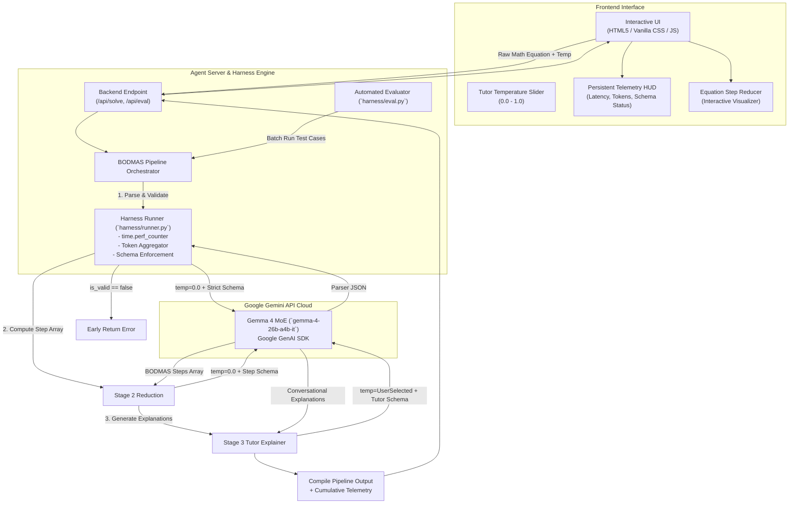

# System Architecture Plan: Lightweight BODMAS Tutor Agent

**Target Model:** Gemma 4 Lightweight MoE (`gemma-4-26b-a4b-it` / 4B active parameters)  
**API & SDK:** Google Gemini API via `google-genai` Python SDK  
**Core Pattern:** 3-Component Instrumented Harness (Runner, Pipeline, Eval) + Telemetry Visualizer

---

## 1. Executive Summary & Design Rationale

The **BODMAS Tutor Agent** is engineered as a deterministic, multi-stage mathematical tutoring system. Rather than prompting a large, general-purpose LLM in a single monolithic conversational prompt (which introduces hallucination, token bloat, and arithmetic precedence errors), this system decomposes the problem into distinct modular phases:
1. **Input Sanitization & Validation** (Deterministic Guardrail)
2. **Algebraic Reduction Engine** (Pure BODMAS State Transitions)
3. **Pedagogical Explainer** (Conversational Tutor)

### Why Gemma 4 Lightweight MoE (`gemma-4-26b-a4b-it`) via Gemini API?
* **High Efficiency & Low Latency:** With 4B active parameters in its mixture-of-experts routing, the model delivers sub-second inference times while drastically slashing latency compared to dense 30B+ models.
* **Cost & Token Economy:** Mathematical step parsing requires concise JSON structures; lightweight active parameter count minimizes computational cost per token.
* **Gemini API Integration:** Utilizing Google's official `google-genai` SDK allows native schema enforcement (`response_mime_type="application/json"` with `response_schema`), streaming capabilities, and built-in usage metadata for telemetry without managing local GPU infrastructure.

---

## 2. End-to-End System Architecture



---

## 3. Repository & Module Layout

```
agent_skill1/
├── harness/
│   ├── __init__.py
│   ├── config.py             # Model names, default temperatures, Gemini client setup
│   ├── runner.py             # Core execution wrapper (telemetry, timing, schema enforcement)
│   ├── schemas.py            # Pydantic schemas & JSON schema definitions for all stages
│   ├── pipeline.py           # 3-Stage BODMAS agent orchestrator
│   └── eval.py               # 1-Click evaluation benchmark & assertion suite
├── web/
│   ├── index.html            # User interface with equation input, visualizer & telemetry HUD
│   ├── styles.css            # Dark mode glassmorphic styling & equation collapse animations
│   └── app.js                # Frontend state management, API calls, and step-by-step playback
├── tests/
│   └── test_cases.json       # Curated edge-case math equations for benchmarking
├── server.py                 # Lightweight backend API server (FastAPI or Flask)
├── requirements.txt          # Python dependencies (`google-genai`, `pydantic`, `fastapi`, `uvicorn`)
└── .env.example              # GEMINI_API_KEY placeholder
```

---

## 4. Component Technical Specifications

### Component 1: The Runner Wrapper (`harness/runner.py`)
The runner isolates the Gemini API communication, enforces safety/schema constraints, and captures granular performance telemetry.

* **Client Initialization:**
  ```python
  from google import genai
  from google.genai import types
  import time
  import json

  client = genai.Client()
  ```
* **Execution Contract:**
  ```python
  def run_gemma_task(
      prompt: str,
      temperature: float = 0.0,
      response_schema: dict | type = None,
      model_id: str = "gemma-4-26b-a4b-it",
      system_instruction: str = None
  ) -> tuple[dict, dict]:
      """
      Executes a prompt against Gemma 4 via Gemini API.
      Returns: (parsed_data, telemetry_dict)
      """
  ```
* **Telemetry Data Captured:**
  * `latency_ms`: Measured via `time.perf_counter()` wrapping the API call.
  * `input_tokens`: `response.usage_metadata.prompt_token_count`
  * `output_tokens`: `response.usage_metadata.candidates_token_count`
  * `total_tokens`: Total token consumption for this specific invocation.
  * `schema_valid`: Boolean flag validating that the JSON matches the expected schema.
* **Error Resilience:** Catches `json.JSONDecodeError`, network timeouts, and model rate limits, returning clean diagnostic errors.

---

### Component 2: The BODMAS Multi-Stage Pipeline (`harness/pipeline.py`)

#### Stage 1: Parser & Guardrail Validator
* **Objective:** Clean input equation, sanitize invalid characters, and verify mathematical syntax.
* **Model Configuration:** `temperature=0.0`, `model="gemma-4-26b-a4b-it"`.
* **Output Schema:**
  ```json
  {
    "is_valid": true,
    "clean_equation": "3 + 5 * (2 - 8)",
    "error_message": null
  }
  ```
* **Circuit Breaker:** If `is_valid` is `false`, the pipeline terminates immediately, returning the error to the user without executing Stages 2 or 3, saving latency and token budget.

#### Stage 2: Step-by-Step Algebraic Reduction Engine
* **Objective:** Execute pure BODMAS reduction without prose or conversational text.
  * **B**rackets (Parentheses) first (innermost first)
  * **O**rders (Powers / Exponents)
  * **D**ivision and **M**ultiplication (from left to right)
  * **A**ddition and **S**ubtraction (from left to right)
* **Model Configuration:** `temperature=0.0`, strict Array Schema.
* **Output Schema:**
  ```json
  {
    "original_equation": "3 + 5 * (2 - 8)",
    "steps": [
      {
        "step_index": 1,
        "rule": "Brackets",
        "focus": "2 - 8",
        "result": "-6",
        "current_equation": "3 + 5 * (-6)"
      },
      {
        "step_index": 2,
        "rule": "Multiplication",
        "focus": "5 * (-6)",
        "result": "-30",
        "current_equation": "3 + (-30)"
      },
      {
        "step_index": 3,
        "rule": "Addition",
        "focus": "3 + (-30)",
        "result": "-27",
        "current_equation": "-27"
      }
    ],
    "final_answer": "-27"
  }
  ```

#### Stage 3: Friendly Pedagogical Explainer
* **Objective:** Translate the cold algebraic reduction from Stage 2 into warm, encouraging, student-friendly tutor commentary.
* **Model Configuration:** `temperature=0.4` (or slider-controlled), JSON schema.
* **Input to Stage 3:** The JSON output generated by Stage 2.
* **Output Schema:**
  ```json
  {
    "title": "Mastering BODMAS: Step-by-Step Breakdown",
    "overview": "We solved 3 + 5 * (2 - 8) by tackling the brackets first, followed by multiplication, and finally addition.",
    "step_explanations": [
      {
        "step_index": 1,
        "heading": "Step 1: Simplify inside the Brackets",
        "explanation": "According to the 'B' in BODMAS, brackets always take priority. Inside (2 - 8), subtracting 8 from 2 gives us -6.",
        "tip": "Keep the negative sign inside parentheses so you don't confuse it with subtraction!"
      },
      {
        "step_index": 2,
        "heading": "Step 2: Multiplication before Addition",
        "explanation": "Next is 'M' for Multiplication. We multiply 5 by -6, yielding -30.",
        "tip": "A positive multiplied by a negative always results in a negative."
      },
      {
        "step_index": 3,
        "heading": "Step 3: Final Addition",
        "explanation": "Lastly, 'A' for Addition. Combining 3 with -30 gives our final result: -27.",
        "tip": "Adding a negative is the same as subtracting: 3 - 30 = -27."
      }
    ],
    "encouragement": "Great job! Remember the BODMAS sequence whenever you see multiple operations."
  }
  ```

#### Pipeline Aggregator & Telemetry Packaging
Before returning to the frontend or caller, the orchestrator compiles the final payload:
```json
{
  "status": "success",
  "clean_equation": "3 + 5 * (2 - 8)",
  "final_answer": "-27",
  "reduction_steps": [ ... ],
  "tutor_explanation": { ... },
  "telemetry": {
    "total_latency_ms": 782.4,
    "stage1_latency_ms": 210.1,
    "stage2_latency_ms": 320.5,
    "stage3_latency_ms": 251.8,
    "input_tokens": 312,
    "output_tokens": 284,
    "total_tokens": 596,
    "model_used": "gemma-4-26b-a4b-it",
    "validation_status": "VALID_JSON_SCHEMA"
  }
}
```

---

## 5. Component 3: 1-Click Evaluation Harness (`harness/eval.py`)

A standalone benchmarking tool designed for automated validation, regression testing, and hackathon presentation.

### Test Suite (`tests/test_cases.json`)
The suite includes 5+ verified edge cases:
1. **Nested Brackets:** `4 + 2 * (3 + (5 - 2) * 2)` $\rightarrow$ Expected: `22`
2. **Division Precedence with Negatives:** `12 / 4 + 3 * (8 - 10)` $\rightarrow$ Expected: `-3`
3. **Exponents / Orders:** `2 ^ 3 + 18 / (9 - 3)` $\rightarrow$ Expected: `11`
4. **Consecutive Multiplications & Divisions (Left to Right):** `24 / 4 * 2 - 3 + 1` $\rightarrow$ Expected: `10`
5. **Syntax Guardrail Rejection:** `8 + * 3 - (4 / )` $\rightarrow$ Expected: `INVALID_SYNTAX`

### Evaluation Report Format
When executed via `python -m harness.eval`, it outputs an formatted ASCII table:

```
========================================================================================
BODMAS TUTOR AGENT: GEMMA 4 BENCHMARK SUITE
Model: gemma-4-26b-a4b-it | Framework: google-genai | Backend: Gemini API
========================================================================================
Test ID | Expression                    | Expected | Agent Ans | Status | Latency  | Tokens
----------------------------------------------------------------------------------------
TC-01   | 4 + 2 * (3 + (5 - 2) * 2)     | 22       | 22        | PASSED | 684 ms   | 512
TC-02   | 12 / 4 + 3 * (8 - 10)         | -3       | -3        | PASSED | 610 ms   | 498
TC-03   | 2 ^ 3 + 18 / (9 - 3)          | 11       | 11        | PASSED | 640 ms   | 505
TC-04   | 24 / 4 * 2 - 3 + 1            | 10       | 10        | PASSED | 592 ms   | 480
TC-05   | 8 + * 3 - (4 / ) [Guardrail]  | INVALID  | INVALID   | PASSED | 195 ms   | 120
----------------------------------------------------------------------------------------
Summary: 5/5 PASSED (100%) | Avg Latency: 544.2 ms | Total Tokens: 2,115
========================================================================================
```

---

## 6. Component 4: Interactive Frontend UI Specification

### UI Structure & Design System
* **Aesthetic:** Modern dark mode with deep navy/charcoal backgrounds (`#0B0F19`), subtle glassmorphism cards (`rgba(255, 255, 255, 0.04)`), and accent highlights (`#6366F1` indigo, `#10B981` emerald).
* **Typography:** Clean sans-serif (`Inter` or `Outfit`) paired with monospace font (`JetBrains Mono` or `Fira Code`) for math tokens.

### Key Interactive Elements
1. **Equation Input & Quick Samples:**
   - Prominent text input with presets (e.g., "Nested Brackets", "Challenging Order", "Exponents").
2. **Tutor Persona Slider (Temperature Control):**
   - Interactive slider mapped to Stage 3 `temperature` (0.0: Strict & Concise $\rightarrow$ 1.0: Expressive & Humorous Tutor).
3. **Step-by-Step Equation Shrink Visualizer:**
   - Interactive step cards displaying the active rule badge (e.g., `[B - Brackets]`, `[M - Multiplication]`).
   - The expression that is actively being calculated is highlighted in glowing amber, transitioning into its resolved value.
4. **Persistent Telemetry HUD:**
   - Live pill badges displaying:
     - ⚡ **Latency:** e.g., `620 ms`
     - 🪙 **Tokens:** e.g., `512 tokens` (Input: 280 | Output: 232)
     - 🛡️ **Schema:** `Validated JSON (Gemma 4)`
     - 🤖 **Model:** `gemma-4-26b-a4b-it`

---

## 7. Implementation Roadmap

| Phase | Milestone | Deliverables |
|---|---|---|
| **Phase 1** | **Runner & Environment Setup** | Configure `.env`, initialize `google-genai` client, create `harness/runner.py` with schema parsing and millisecond timers. |
| **Phase 2** | **3-Stage Pipeline Implementation** | Implement `harness/pipeline.py` with Stage 1 (Validator), Stage 2 (Algebraic Steps), and Stage 3 (Tutor Explanations). |
| **Phase 3** | **Evaluation Suite & Test Cases** | Build `harness/eval.py` and `tests/test_cases.json`, verify 100% test pass rate with terminal reporting. |
| **Phase 4** | **Backend API & Web UI** | Create `server.py` and the visualizer frontend (`web/index.html`, `styles.css`, `app.js`). |
| **Phase 5** | **Testing & Verification** | End-to-end verification via browser testing, measuring live latency and token telemetry. |
